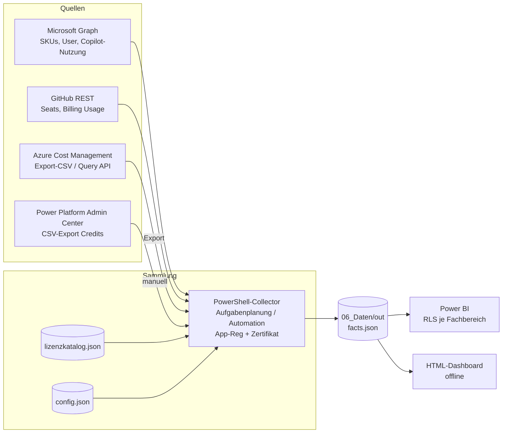

# Konzept – Copilot-FinOps

> Kunde: **[Name, Branche, Mitarbeiterzahl – offen]** · Angaben mit **[prüfen]** vor Produktivsetzung gegen Microsoft Learn bzw. die Preisliste des Kunden verifizieren.

## 1. Ziel
Das Tool stellt die Kosten aller Copilot-Produkte zentral und monatlich dar, zugeordnet nach Fachbereich. Es ist die Grundlage für Budgetsteuerung, Showback/Chargeback und Lizenzoptimierung und richtet sich an IT-Leitung, Controlling und Fachbereiche.

## 2. Kostenarten je Produkt und Datenverfügbarkeit

| Produkt | Kostenart | Datenquelle | API verfügbar? |
|---|---|---|---|
| M365 Copilot Chat | kostenfrei (Basis) | Graph-Nutzungsberichte | ja, teilweise beta [prüfen] |
| Copilot Chat – Agent-Nutzung | Verbrauch (PAYG über Billing Policy → Azure-Abo) [prüfen] | Azure Cost Management | ja |
| Microsoft 365 Copilot | pro User | Graph `subscribedSkus`, `users`, Nutzungsbericht | ja |
| Copilot Studio Capacity Packs | Kapazität (Credits) | Graph (Kauf), PPAC (Verbrauch) | Verbrauch je Agent: **keine stabile öffentliche API bekannt** → CSV-Export [prüfen] |
| Copilot Studio PAYG | Verbrauch | Azure Cost Management | ja |
| Copilot in Azure | derzeit ohne separate Gebühr [prüfen] | – | manuell |
| Azure OpenAI / Foundry | Verbrauch | Azure Cost Management | ja |
| GitHub Copilot | Seats + Premium Requests | GitHub REST | ja [prüfen] |
| Security Copilot (optional) | Kapazität (SCU) | Azure Cost Management | ja [prüfen] |

## 3. Architektur

**Datenmodell (Sternschema):** Die Fakttabelle *Kosten/Verbrauch* (Monat, Produkt, Fachbereich, Region, Menge, kostenIst, Agent, Umgebung, zugewiesen, aktiv, unlizenziert) ist mit den Dimensionen Datum, Produkt (= Lizenzkatalog), Fachbereich, Region und Agent verknüpft. Eine eigene User-Dimension gibt es bewusst nicht, weil die Daten bereits aggregiert vorliegen (Datenschutz).

## 4. Datenquellen und Berechtigungen (Least Privilege)

| Quelle | Berechtigung | Hinweis |
|---|---|---|
| Graph `subscribedSkus` | `Organization.Read.All` (Anwendung) | – |
| Graph `users` | `User.Read.All` (Anwendung) | Fachbereichsfeld konfigurierbar |
| Graph Copilot-Nutzungsbericht | `Reports.Read.All` (Anwendung) | `getMicrosoft365CopilotUsageUserDetail`, ggf. nur beta [prüfen] |
| Azure Export | Leserechte auf Storage Account | empfohlen: keine Limits der Query API |
| Azure Query API | **Cost Management Reader** | max. 2 Gruppierungen [prüfen]; Zuordnung nur über Meter-Name |
| PPAC | Power Platform Admin (manueller Export) | API [prüfen] |
| GitHub | Fine-grained Token / GitHub App mit Billing-Lesezugriff | Token als Umgebungsvariable |

Die Authentifizierung läuft über eine App-Registrierung mit **Zertifikat**, nicht über ein Secret. Für Azure Automation ist künftig eine Managed Identity möglich (nicht umgesetzt).

## 5. Sicherheit und Datenschutz
- Der Collector speichert **keine UPNs**. Er gibt ausschließlich Werte aggregiert nach Fachbereich und Region aus.
- **Mindestgruppengröße** (`MinGroupSize`, Standard 5): Kleinere personenbasierte Graph-/GitHub-Gruppen werden je Monat und Produkt zu „Sonstige“ mit gemischter Region zusammengefasst. Die Sammelgruppe kann weiterhin kleiner als der Schwellwert sein. Dies ist keine garantierte Anonymisierung: kleine aktive/inaktive Teilmengen, zeitliche Vergleiche und Zusatzwissen können Rückschlüsse ermöglichen. Agent-/Umgebungsnamen aus Importen bleiben erhalten und können ihrerseits sensible Angaben enthalten. Zugriffsrechte und fachliche Datenschutzprüfung bleiben erforderlich.
- **Keine Leistungs- und Verhaltenskontrolle:** Es gibt keine personenbezogenen Ranglisten. Vor der Einführung die Mitbestimmung nach § 87 Abs. 1 Nr. 6 BetrVG klären und eine DSFA-Schwellwertanalyse durchführen.
- Die frühere Option „Pseudonymisierung“ ist entfallen, weil keine personenbezogenen Einzeldaten mehr ausgegeben werden.

| Rolle | Sicht | Rechte |
|---|---|---|
| Admin (IT/FinOps) | alle Daten | Katalog, Collector, Konfiguration |
| Controlling | alle Fachbereiche (aggregiert) | Budgets, Kundenpreise |
| Fachbereichsleitung | nur eigener Fachbereich (RLS) | lesen |

## 6. Frontend: Power BI vs. HTML

| | Power BI | HTML-Dashboard |
|---|---|---|
| **Vorteile** | RLS, Freigabe in M365, geplanter Refresh, Drill-down, Abos per Mail | keine Lizenz, offline, sofort nutzbar, ideal für Workshop/PoC |
| **Nachteile** | Power-BI-Lizenzen für Konsumenten [prüfen], Gateway bei lokaler Ablage | keine Zugriffskontrolle (wer die Datei hat, sieht alles), kein zentraler Refresh |

**Empfehlung:** Für den Produktivbetrieb **Power BI** einsetzen, weil RLS je Fachbereich gefordert ist. Das HTML-Dashboard eignet sich für Kick-off, PoC und Offline-Auswertungen durch IT und Controlling.

## 7. Preislogik (in allen Schichten identisch)
1. Liefert die Quelle einen Betrag (`kostenIst`, z. B. Azure oder GitHub), wird dieser verwendet.
2. Sonst gilt Menge × **Kundenpreis**, ersatzweise × **Listenpreis** in derselben Währung. Maßgeblich ist der Katalogeintrag am ersten Tag des jeweiligen Monats. Bei Jahrespreisen für `ProUser` wird durch zwölf geteilt.
3. Ist kein Preis gepflegt (`[prüfen]`), werden die Kosten mit 0 angesetzt und als „Produkte ohne Preis“ ausgewiesen.

Währungen werden nicht addiert oder umgerechnet. Das Dashboard bietet eine Währungsauswahl; Geld-Measures in Power BI bleiben bei gemischten Währungen leer. Unbekannte Nutzung (`aktiv: null`) bleibt unbekannt: Auslastung und Einsparpotenzial werden daraus nicht berechnet. Die technische Sammlung und Preisberechnung ersetzt keine Rechnungsabstimmung.
